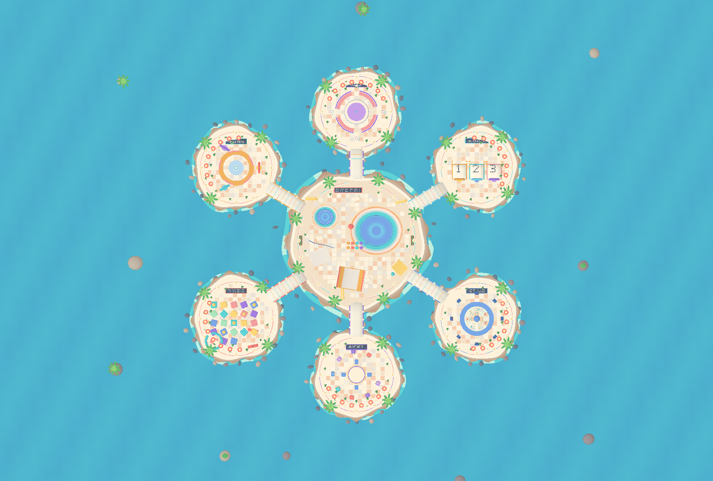
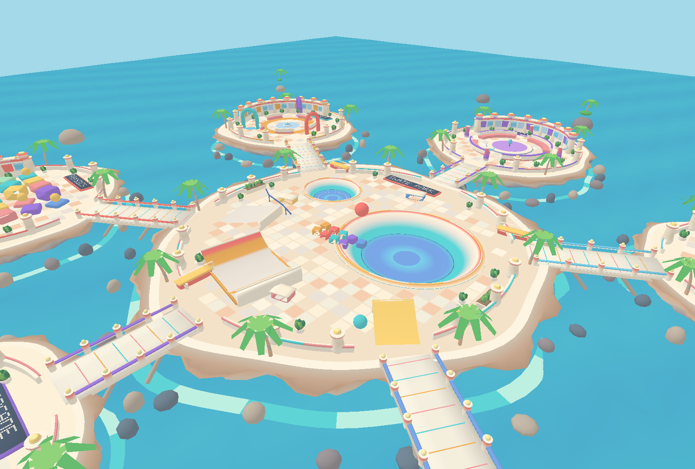
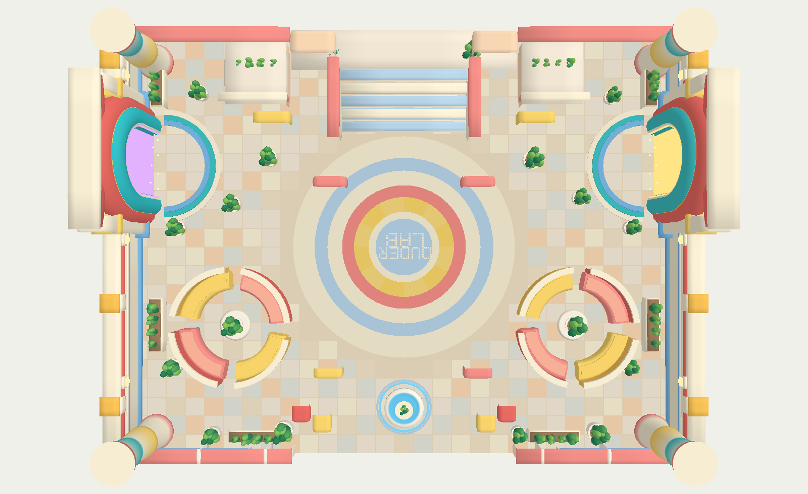

# DuderWorld V0.4 — procedural level generation for TrontEOS

**Standalone offline V0.4 layout studio:** [static.html](static.html).
**Original V0.3 authored world and GLB remain intact:** [duderworld-v0-3.html](duderworld-v0-3.html).

V0.4 is a **tooling upgrade**, not a multiplayer minigame: DuderLab creates characters, DuderWorld builds environments, and Unity/TrontEOS owns networking, rigidbodies, gameplay and final runtime assembly. The offline studio is a lightweight WebGL/Canvas inspection tool. It is deliberately *not* a replacement for the full V0.3 art; the production `src/archipelago.mjs` now consumes the same deterministic layout graph.

- 3–12 island recipes; radial, ring, chain or hybrid bridge graphs
- Seeded layout variation, collision-free footprints, semantic zone names
- Original V0.3 seven-island preset preserved as the default
- Bridge openings driven by adjacency rather than hardcoded centre spokes
- JSON recipes, Unity semantic metadata, collision proxies, navigation links
- Static grouped GLB export from the studio (physics actors are not baked as actors)
- WebGL2 display with Canvas2D fallback for restricted QA browsers

```sh
npm ci
npm run test:layout
npm run build:studio
npm run test:archipelago
npm run export:worldmeta -- -- # optional recipe/output arguments
```

**Important scope note:** the V0.4 standalone studio uses a simplified geometry preview. The existing V0.3 Three.js source retains its higher-detail 305,750-triangle art and now accepts `{islandCount, topology, variation, spread}`. Existing V0.3 prebuilt GLB and HTML remain unchanged. In the V0.3 generator, some decorative physics toys are still baked into the scenery; the metadata defines future separately spawned interactables for Unity, rather than claiming those have been decoupled already.

---

# DuderWorld V0.3 — Tront-EOS social archipelago

**The newest scene is [duderworld-v0-3.html](duderworld-v0-3.html).** Open it
directly in a modern desktop browser: it is a **self-contained, offline**
Three.js island world, no server, license-sensitive imported models, or CDN.





The [original archipelago concept](docs/concepts/duderworld-archipelago-concept-v0-3.png)
is an aspirational illustration. V0.3 models its seven-area layout with:

- One 47 m-wide central skate park: **two actual recessed bowl openings**
  through the floor, curved halfpipe, kicker ramps, grind rail, toy blocks,
  spectator benches and promenade.
- Six physically connected smaller islands: friends plaza, positional voice
  lounge, three matchmaking/session gates, co-op physics yard, arcade,
  and networking observatory.
- Irregular layered rocky coastlines, styled cliffs, foamy shoreline,
  arched bridges with posts and structural supports, curved walls, towers,
  lighthouses, neon panels, signs, pavers, palm trees and islands.
- All baked geometry is **indexed with authored normals and vertex colors**,
  with independent mesh groups for the seven islands, bridges, water and
  offshore details. The default build contains **305,750 triangles /
  227,625 indexed vertices / 18 static material batches**.
- **60 instanced preview duders** populate all seven areas, waving,
  walking and performing choreographed aerial tumbles. These animations
  are **not real ragdoll physics and not connected to EOS**. They are
  viewport-only scale references and do not enter the GLB export.

Controls: drag orbit; right-drag pan; mousewheel zoom; press **1** for
top-down, **2** or **F** for walk mode, click to capture the mouse, move with
**WASD**, sprint with **Shift**, release pointer lock with **Esc**.
The UI adjusts island spacing, level-of-detail and greenery, and supports
**reroll**, outline preview, show/hide duders, recipe JSON export and
**BAKE UNITY GLB**.

For direct import, use [duderworld-archipelago-v0-3.glb](duderworld-archipelago-v0-3.glb):
11.9 MB, glTF 2.0 with 18 mesh primitives under spatially grouped nodes.
Unit = 1 meter, +Y up, platform top = 0 meters. Unity still needs
colliders, spawned networked rigidbodies, navigation, duder controllers
and actual EOS integration; scenic skateboards/balls/blocks in this bake
are not individually networked interactables.

### Rebuild and validate V0.3

Run within this repo after npm ci:

- npm run build:archipelago — creates the standalone V0.3 HTML.
- npm run bake:archipelago — creates the indexed GLB.
- npm run test:archipelago — checks the entire mesh including normals,
  triangulation, both bowl holes, and the six bridge landings.

The three docs/media/duderworld-v0-3-* PNGs are independent Mesa GLES 3
software renderings of the baked GLB for geometry verification. Their simple
shading does not represent Three.js lighting or a browser benchmark.

---

## Previous geometry-only interior (V0.2)

A parametric, dense 3D lobby environment for future **Tront-EOS** demo scenes. The second geometry pass is a deliberate response to the generated top-down concept: the first room lacked architectural height, portal recesses, details, colour and landscaping. This build contains **level geometry only**: no duder characters, networking, physics, navmesh, or objectives.



## Play with the level

Open **`static.html`** directly in a WebGL2-capable browser. The single HTML file contains Three.js, OrbitControls, GLTFExporter, geometry code, shaders, and UI. It works using `file://` without a server or CDN.

- Drag to orbit, right-drag to pan, scroll to zoom.
- `T` switches the overhead orthographic camera on/off.
- `O` toggles the thin preview-only reverse-cull shell outlines. They start **off** so the stacked architectural details look clean; the GLB never includes them.
- `R` restores the recipe. Use the sliders for width, depth, plaza radius, and profile resolution; reroll changes plant placement deterministically.
- **Save Recipe** downloads the current JSON. **Bake GLB** downloads the currently selected geometry with welded indexed records, smooth normals, and vertex colors.

The baked [duderworld-lobby-v0-2.glb](duderworld-lobby-v0-2.glb) is also included for immediate import through a glTF-capable Unity importer. It stores ordinary static meshes: a common vertex-coloured environment mesh and one emissive/portal mesh. The preview outline shell, Three.js lights, controls, and UI are deliberately excluded from the export. One scene unit equals one metre.

## Geometry implementation

`src/world.mjs` is the only source of level shapes. It generates two indexed geometry batches directly from `DEFAULT_RECIPE` plus editable parameters. No stock 3D models, external textures, or AI-generated images are imported into the scene.

| Operation | Lobby geometry |
| --- | --- |
| Continuous radial tessellation | Colourful integrated central plaza medallion with baked geometric DUDER LAB lettering |
| Offset ceramic tile patches | Subtly varied square floor tiles surrounding the medallion; no texture maps or extra material calls |
| Rounded-box SDF projection | Substantial layered perimeter, portal recesses and crowns, riser stairs, terrace, wall trim, illuminated sconces |
| Closed sweeps and curved solids | Nested portal arches, layered threshold steps, four-part sofas with separate backrests and seat cushions |
| Lathed profiles | Striped corner towers, planters, lobby fountain and integrated lounge tables |
| Analytic ellipsoids | Dense stylized succulent clusters and long planter troughs |
| Paired rendering buckets | Opaque architectural geometry + emissive portal/water/lights; **two scene mesh batches** |

Smooth normals are authored for these shapes; identical compatible position/normal/colour records are welded into each indexed batch. Colour seams retain distinct records where required. Architectural pieces are intersecting solids, not a single boolean-unioned watertight mesh. Geometry is immutable once built; changing a recipe regenerates it deterministically.

Default 32 m × 24 m level: **66,822 triangles, 39,459 indexed vertex records, and two static geometry batches**. The optional preview shell and shadows add their own rendering work; these counts are not total rendering passes or a hardware benchmark. The heavier geometry is the consequence of modeling more of the concept rather than painting flat decals.

## Source and bake

With Node installed:

```sh
npm ci
npm run build
npm run bake
npm test
```

`npm run build` creates the offline `static.html` using esbuild. `npm run bake` creates the default GLB using Three.js `GLTFExporter`; the viewer's download button bakes whichever recipe is currently shown instead. `npm test` runs geometry checks across 27 width/depth/detail combinations plus a GLB roundtrip through Three.js's loader.

Independent Mesa/GLES captures in `docs/media/` confirm the *same generated geometry buffers* from two angles, using a deliberately basic validation shader rather than Three.js's lighting setup. They are not browser screenshots or performance measurements. The Three.js viewer is the intended interactive visual reference.

## Unity handoff

Import the `.glb` with a glTF-compatible importer in Unity, then add static colliders, spawn points, navigation, interaction volumes and EOS networking. Those systems are intentionally out of scope here. A single merged mesh is easy to render and rigidly bake, but you'll likely want per-room collision proxies and instanced decoration for a shipping scene with many copies.

## Bundled licenses

The character and environment meshes are original deterministic procedural geometry, not imported art packs. The build bundles **Three.js 0.180.0** (MIT) and uses **esbuild 0.25.12** (MIT) as a build dependency. Their license texts are retained in [THIRD_PARTY_NOTICES.md](THIRD_PARTY_NOTICES.md). No project-wide license has been assigned to the DuderWorld-specific source.
