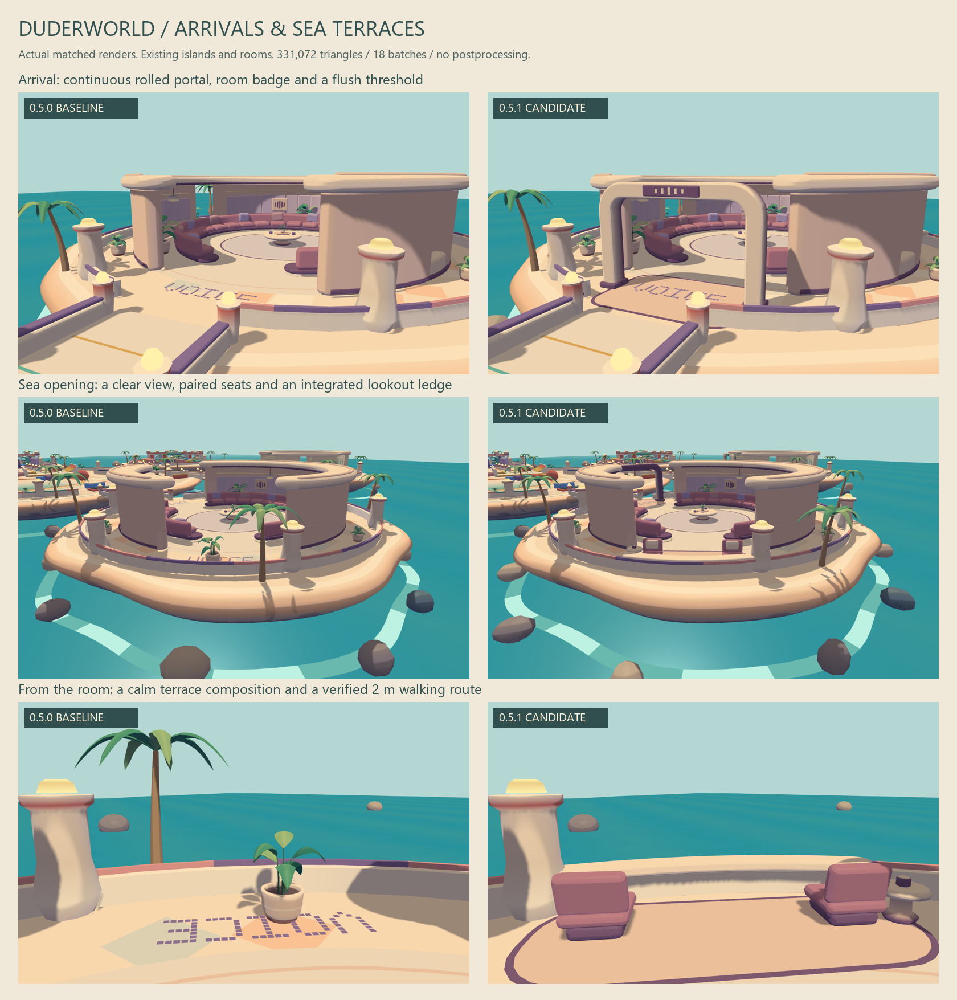
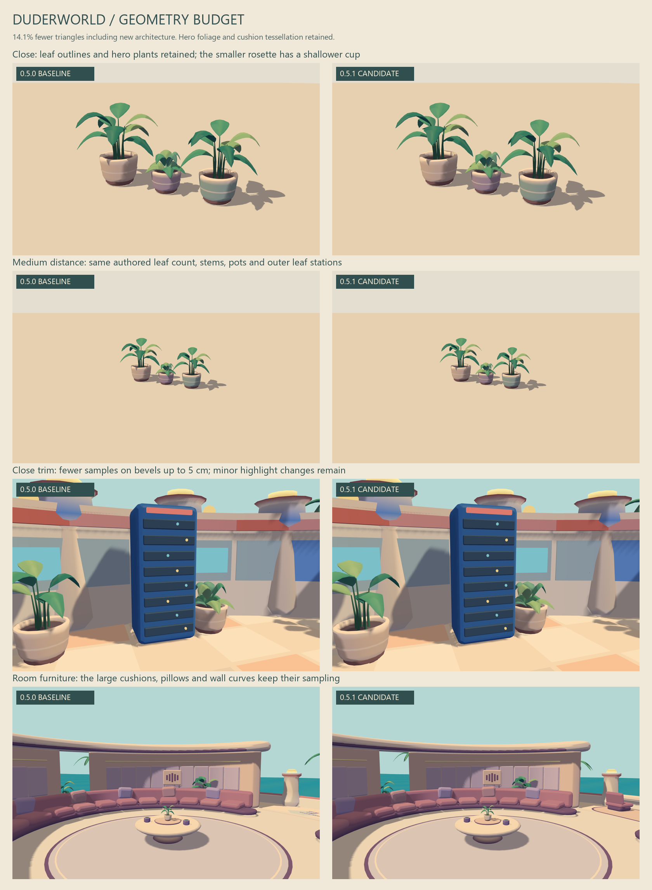

# DuderWorld 0.5.1: arrival and terrace candidate

Local continuation of `TrentSterling/duderworld`, preserving the 0.5.0 art
checkpoint `644136e0d193dfd781c4c4aca81ecbe1aad7211e`. Branch:
`codex/terrace-geometry-budget-20261025`. No push, merge, deployment or publication.

## Visible changes

The existing Voice and Friends rooms now have an open, continuously swept
arrival portal, a recessed badge and flush threshold inlays. Their existing
sea-facing openings have two leaning lounge seats, a side table, a broad
parapet ledge and a calm floor inset. A shoreline palm was moved to frame the
opening after the first render showed its trunk obstructing the sea view.
Redundant room lettering was removed from the terrace floor.

This pass does not add islands or redesign the other activity rooms. The
opaque NPR treatment, authored plant silhouettes, major wall curves and room
upholstery remain. All static additions use existing island batches.

## Geometry attribution and tradeoffs

Disposable instrumented generator bundles profiled the preserved commits and
working candidate without modifying production generators. Nested calls have
separate inclusive/exclusive counts; they must not be added together blindly.
At 0.5.0, leaves cost 109,304 triangles and rounded boxes cost 84,900.

| Budget step | Triangle delta |
|---|---:|
| 0.5.0 starting point | 385,348 |
| Nonhero leaf width samples: five to three | -40,320 |
| Bevel samples on trim with radius at most 5 cm | -20,544 |
| Straight ramp extrusion: nine spans to one | -416 |
| New arrival/terrace assemblies | +9,808 |
| Two perimeter plants removed from the terrace grouping | -2,424 |
| Redundant terrace floor lettering removed | -380 |
| **0.5.1 result** | **331,072** |

Net reduction: **54,276 triangles / 14.1%**. Vertices fall from 292,636 to
258,984. Static batches remain 18. Relative to the older 0.4.1 checkpoint,
the candidate is still 14.8% more triangles; the new art is not free.

All longitudinal leaf stations, outer edges, stems and the center rib remain.
Hero leaves retain five width samples. Nonhero leaves have a shallower polygonal
cup between their retained samples; the maximum analytic cross-section change
is curl/4 (about 1.9 cm on typical leaves, 2.25 cm on palms). Matched close and
medium renders show a minor shading change, especially on the low rosette.
Small trim bevels have at most about 3.8 mm circle-chord error at 5 cm radius;
their highlights can change slightly. Large cushions and rounded architecture
retain their sampling. The straight ramp reduction is surface-equivalent.

## Renderer measurements

RTX 5070 Ti, ANGLE D3D11, muted headless Chromium, 1600 x 1000 DPR 1. Four
counterbalanced pairs per view, 60 warmup frames and 240 GPU timer queries per
run, fixed animation time. No concurrent GPU test ran; geometry validation
finished before timing. Invalid/disjoint query count was zero. These are
desktop observations, not Quest qualification.

| Paced GPU time, median of four run medians | 0.5.0 | 0.5.1 |
|---|---:|---:|
| World | 2.809 ms | 3.333 ms |
| World run-median range | 2.714–2.900 ms | 3.090–3.372 ms |
| Voice | 3.078 ms | 2.816 ms |
| Voice run-median range | 2.976–3.219 ms | 2.674–3.057 ms |
| Arrival | 2.716 ms | 2.867 ms |
| Arrival run-median range | 2.632–2.724 ms | 2.791–2.933 ms |

The paced world result is **18.7% slower**, despite fewer triangles. Every
baseline world run ended in P3 with 7001 MHz memory, while every candidate
world run ended in P5 with 810 MHz memory. These are boundary observations,
not continuous clock telemetry, and do not prove that power state explains
the entire difference. Voice and arrival results are likewise mixed. There
is no reliable interactive speedup claim.

All-pass draws stayed 38/26/24 for world/voice/arrival. Corresponding submitted
triangles fell from 840,682/497,304/438,800 to 735,202/475,200/417,266.

A separate short static diagnostic submitted blocks of 32 identical renders, with GPU
completion between blocks (40 warmup, 120 measured blocks, four world pairs).
Before/after snapshots, not continuous telemetry, showed both versions at P1, approximately 2900 MHz core / 13801 MHz memory.
Median block query time was 3.625 ms baseline versus 3.481 ms candidate
(3.9% lower). Ranges were 3.609–3.676 and 3.440–3.505 ms. Each block submitted
1,216 draws. Repeated static renders amortize work and can exercise driver
optimizations; these figures are **not interactive frame times or FPS**.
They provide a separate GPU submission diagnostic, not a replacement for the
slower paced world result. GPU completion and query-polling overhead are outside
the query interval; no per-block CPU wall time was recorded, so these are not
wall-clock throughput measurements. Independent review verified 32 full render
submissions per query and no invalid blocks. No clocks, power policy or other
OS settings changed.

Raw runs, generator profiles and the machine-readable summary accompany the
review package. Final HTML SHA-256:
`7448bf04abdace4c173ed39b9b59bf2caf1517d97b28fa53cd11559e60ff96b2`.

## Verification and remaining limits

- Full `npm test`: 27 historical recipes, 360 layout checks, two bowl openings,
  zero winding errors or degenerate triangles, and five closed-box topology cases.
- 310 standing-height mesh raycasts retain 3 m bridge approach lanes across six
  recipes. Another 84 raycasts verify a 2 m terrace route. Analytic navigation
  agrees and blocks the new chairs, tables, piers and parapet.
- Alternate graph layouts omit individual outdoor pieces when they would
  obstruct a bridge approach. Metadata describes the resulting assemblies.
- Headless browser focus controls, walk/top-down and crowd/outline toggles,
  layout controls, repeated rebuilds and actual recipe/metadata/GLB downloads pass.
  No page or shader-console errors; 24 resident geometries and one shadow texture.
- Browser/native expanded GLB triangle positions, normals and colors match
  exactly. Export contains 18 static meshes and excludes the preview crowd.
- Independent read-only art/technical review inspected matched close and medium
  plants, cushions, network trim, arrivals and refreshed terrace views. No
  blocking issue remained. The previously overlooked cabinet close-up was added.

Five renderer-only shadow variants were inspected. Lower bias and front-face
casters did not improve pots and room details consistently. Existing settings
remain; close-range pot-rim, parapet and older-backdrop shadow aliasing is still
visible. There is no claim that shadow quality is solved.

GLB retains Standard materials/mesh colors; the live NPR shader needs a Unity
render-pipeline port. Collision proxies are still coarse. Unity import, Quest,
stereo, sustained thermal behavior, EOS networking and ragdoll simulation were
not qualified. All work used background/offscreen/headless tools, without
physical input, pointer lock, focus stealing, audio playback or global settings.
